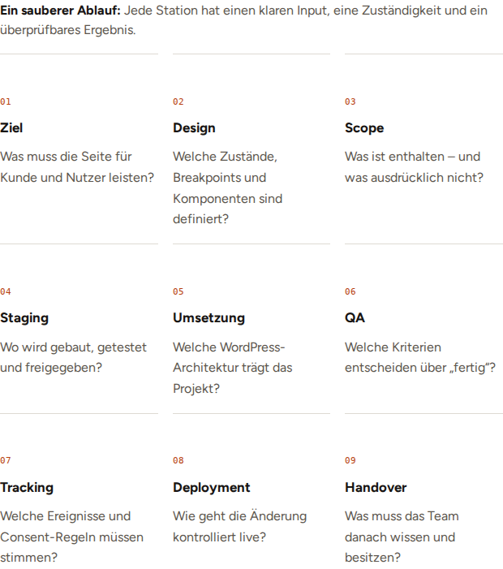
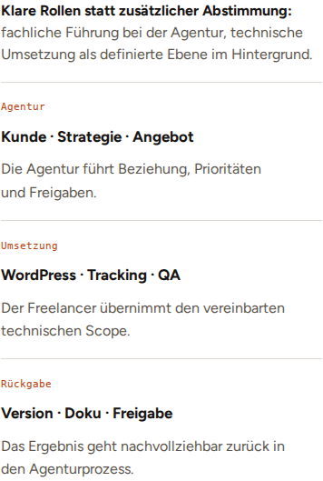
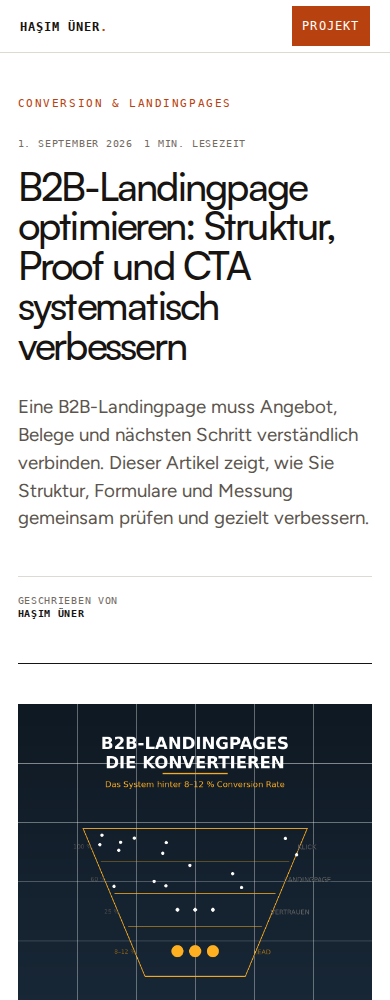
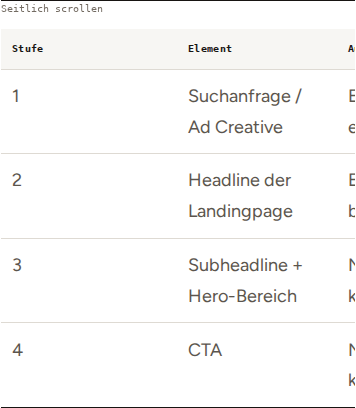

# BD-NEXT@2026-11-01-v2 · Agenturmodule und Landingpage-Reader

Hasims fortgesetztes Go zur schrittweisen Blog-Umsetzung liegt vor. Dieses Paket
baut auf Reader-v2 (`e677ddb`, PR #634) auf. Der separate PR richtet sich deshalb
zunächst gegen `feat/blog-reader-wartung-relaunch`. Nach dessen Merge auf den
aktuellen `main` umstellen. Kein Merge oder Produktionsdeploy dieses Pakets.
Claudes unabhängiges Urteil ist weiter offen.

## Änderungen und belegte Ursachen

- Der Reader dequeuet die alte Agentur-Seitenskin samt Inhaltsmodulregeln.
  Die neun bestehenden Übergaben und drei Rollen erhalten gezielt ihre
  Darstellung in `article-reader-body.css`: Nummer, Titel und Beschreibung
  getrennt, Haarlinien, native Reihenfolge, keine künstliche Schrittanimation.
  Ab 34rem verfügbarer Komponentenbreite drei Spalten, darunter eine.
  Ohne Container Queries bleibt die vollständige vertikale Darstellung.
- Der Landingpage-Hero verwendet derzeit einen automatisch gekürzten Auszug.
  Eine eigene Migration schreibt den kurzen Vorspann ausschließlich in ein
  **leeres** `post_excerpt`. Eigene Editor-Auszüge bleiben erhalten; bei Fehler
  oder fehlendem Artikel bleibt ein Wiederholungsversuch möglich. Haupttext,
  Titel, URL, Kategorien und SEO-Metadaten werden nicht neu geschrieben.
- Die mobile `1fr`-Spur konnte durch die intrinsische Tabellenbreite wachsen.
  Am 390px-Viewport lag die ganze Landingpage-Lesespalte dadurch bei x=-133px
  und 656px Breite, obwohl die Dokumentbreite selbst keinen Überlauf meldete.
  Spur mit `minmax(0, 1fr)` und Artikel mit Minimum 0 verhindern diese verdeckte
  Ausweitung. Direkte Tabellen bleiben native Tabellen in begrenzter, seitlich
  scrollbarer Fläche; kleine Ansichten erhalten einen sichtbaren Hinweis.
  JavaScript ergänzt Tastaturfokus und Tabellenname aus vorhandenen Kopfzellen.
  CSS und native FAQ funktionieren auch ohne JavaScript.
- Die bereits versionierte Agentur-Risikomatrix bleibt ihre eigene beschriftete
  Scrollregion. Gerade bei 200% Schrift darf die innere Tabelle breiter sein,
  solange alle Spalten in dieser fokussierbaren Region erreichbar bleiben.

## Validierung

15 gezielte Browserfälle: Wartung/Relaunch weiterhin bei 390/1440 plus Wartung
ohne JS; Auslagern/Landingpage bei 320/390/768/1440; beide neuen Artikel ohne JS.
Geprüft werden reale Templates, Repo-Agenturinhalt, ein datierter öffentlicher
Landingpage-Inhaltsstand, vorhandene Bilddateien, Spaltengeometrie, Nummer/
Titel/Text-Abstände, Rollen, Tabellenfokus und horizontale Bedienung, native
FAQ, TOC-Fokus, dynamisches Reduced Motion und 200% Text. Ausgewählte Ansichten
sind unten dokumentiert und visuell geprüft.

28 gemeinsame Nicht-Browser-Prüfungen bestanden:
`npm run check -- --skip-doctor --skip-browser`;
Architektur, PHP-Syntax und PHPStan eingeschlossen. Der aktuelle Theme-Build
wurde nach dem abschließenden CSS-Stand erneut erfolgreich geprüft. Kein Validator wurde
für diesen Auftrag gelockert. Die Datenmigration hat außerdem eigene Fälle für
leeren/eigenen Auszug, Wiederholbarkeit, fehlenden Artikel und Schreibfehler;
diese sind Teil von `npm run test:permalinks`.

Die lokale Werkzeugumgebung nutzt Node 24 / PHP 8.3.6 und Chrome Headless 153,
nicht die vollständig gepinnte Repo-Toolchain. Der Doctor wurde ausdrücklich
übersprungen. Browserfälle lokal mit je frischem Single-Process-Browser wegen
Prozessgrenzen; die versionierte CI-Konfiguration bleibt unverändert.
Die vollständige CI ist getrennt zu bestätigen.

## Grenzen und offene Inhaltsarbeit

Die WordPress-Datenbank wird durch die vorhandene Template-Fixture ersetzt.
Die Auszugsmigration ist als Callback geprüft; eine tatsächliche WordPress-
Datenbanktransaktion oder Produktionsauslieferung wurde nicht behauptet.
Datums-/Lesezeit- und Altwerte im Harness sind Testwerte. Die Bildkopien in
`scripts/tests/fixtures` kommen von den bestehenden öffentlichen Anhängen 15336
(1672×941) und 14804 (1200×1200); keine neue Featured-Zuordnung, kein Bildtausch.
Das mobile Quadrat bleibt mit Reader-v2 vollständig sichtbar. Das alte Motiv
enthält weiterhin eine ungeprüfte Prozentbehauptung; der zuvor erzeugte neue
Bildentwurf ist noch nicht eingebunden oder als freigegeben bezeichnet.

`landingpage-live-2026-11-01.html` ist der über WPWriter gelesene, unveränderte
öffentliche Artikelstand als **archivierte Prüfquelle**, kein auszuliefernder
Seed. Alte Kennzahlen, pauschale Benchmarks, Journey-Audit-Texte und der
Solar-Marktcheck-Link bleiben als konkrete Inhaltsaltlasten erfasst. Dieses
UI-Paket bestätigt diese Aussagen nicht und veröffentlicht keine Kopie davon.
Keine neue Vollanalyse oder pauschale inhaltliche Artikelabnahme.

Keine Anfrage oder Newsletter-Anmeldung abgeschickt. Keine
Claude-Prüfung ausgelöst oder unter seinem Namen bestätigt. Nächste fachliche
Einheit: Tracking und „Keine Anfragen“, anschließend TTFB.

Frontend-Guides: `responsive-design` (komponentenabhängige Layouts) und
`responsive-table` (native Tabellen/Kopfzellen erhalten). Bestehende kurze
TOC-Rückmeldung bleibt, kein zusätzliches Scroll-Reveal für Inhaltsmodule.

## Visuelle Nachweise der lokalen Vorlage

