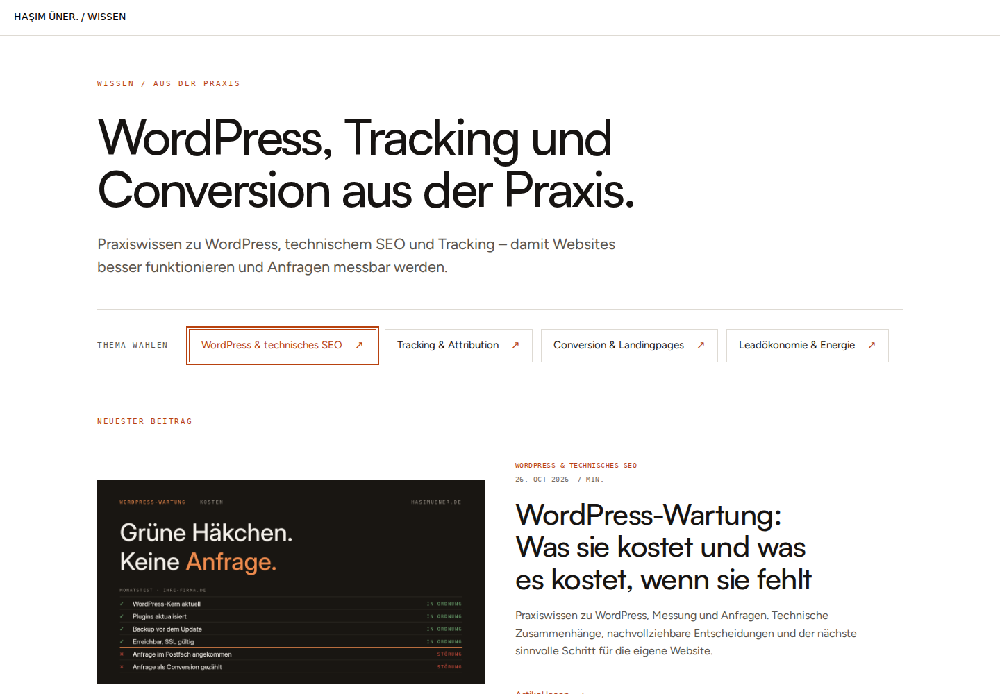
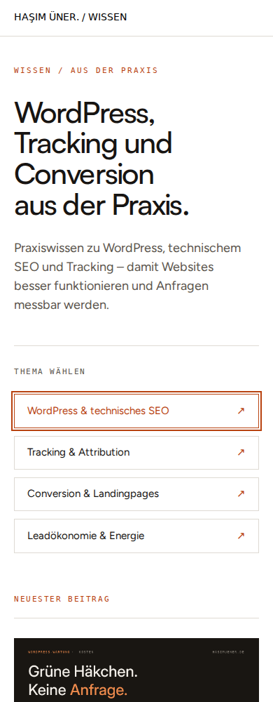

# Blog-Einstieg · BD-ENTRY@2026-10-31-v1

Umsetzung des von Hasim gezeigten Designpakets BD@2026-10-31-v1 nach seinem
konkreten Go vom 31.10.2026. Dieses erste Paket umfasst Blog-Einstieg und
gemeinsame Archivkarten; es zählt keinen der sieben Artikel als fertig.
Claude hat zum Zeitpunkt dieser Ablage noch kein fachliches Urteil geliefert.
Prüfversion, nicht veröffentlicht.

## Verhalten

- Neuer Titel und Einleitung; Themenzugang unmittelbar im Hero. Die fehlerhafte
  Vererbung der alten `.meta`-Infotafel entfällt.
- Neuester Beitrag vor dem Archiv; Zusammenarbeit nach den Artikeln.
- `template-parts/blog-card.php` wird von Blog und Kategoriearchiven verwendet.
  Vorhandene Bilder bleiben vollständig sichtbar; bildlose Beiträge erhalten
  eine klar dekorative Themenfläche. Keine neue Bildzuordnung in WordPress.
- WordPress-Loop, Veröffentlichungssortierung, Pagination und bestehende
  Anfrageziele bleiben bestehen. Themenlinks umbrechen auch in Kategorien und
  behalten mindestens 44 px hohe Trefferflächen.
- Kurze Kartenrückmeldung mit den bestehenden Motion-Tokens. Bei reduzierter
  Bewegung kein Pfeilversatz. Der Abo-Dialog fokussiert sofort das Eingabefeld
  und schließt sofort mit Fokus-Rückgabe; seine kurze Öffnungsanimation ist
  reduzierbar. Der zusätzliche schwebende Abo-Button entfällt; der Zugang am
  Blogabschluss bleibt und kann den KI-Button nicht mehr überdecken.

## Nachweise

- 28 gemeinsame Nicht-Browser-Prüfungen bestanden über
  `python3 scripts/check.py --skip-browser`, einschließlich PHP-Syntax,
  Architektur, PHPStan, Kanon, Routing, Permalinks, Motion, Assets und Theme-Build.
- Neun zusätzliche Browserfälle bestanden: Blog/Kategorie bei 390, 768 und
  1440 px; Seite zwei und leerer Bestand; ohne JavaScript; Tastatur/Modalfokus
  und dynamischer Wechsel zu Reduced Motion. Alle Kartenbilder wurden vor den
  Screenshots tatsächlich geladen und geprüft.
- Exakte Projekt-CLI: PHP 8.3.33, Node 22.23.3, npm 10.9.9, Composer 2.10.3.
  Browser: offizieller Chrome Headless Shell 153.0.8010.12. Wegen der lokalen
  Prozess-/Socketgrenzen lief jeder Fall mit frischem Browserprozess im
  Single-Process-Modus; CI verwendet weiterhin die normale Browserkonfiguration.
- Die neue Suite hängt in `navigation.config.cjs` und läuft damit im bestehenden
  CI-Browserjob. Die übrigen Browser-Suiten sind lokal nicht erneut gelaufen;
  ihre vollständige CI-Ausführung ist gesondert zu bestätigen.
- Modern-Web-Guidance: `responsive-design` (clamp mit relativen/festen Grenzen,
  reservierte Bildflächen über aspect-ratio, vollständige responsive Bilder).

Die Aufnahmen rendern die echten `home.php`, `category.php` und `blog-card.php`
mit echten Theme-Assets und einem deterministischen WordPress-Daten-/Loop-Ersatz.
Sie zeigen keine laufende WordPress-Installation: Der Header ist vereinfacht,
die Beitragsauszüge und Lesezeit sind Testdaten. Die ausgewählten Artikeltitel,
Veröffentlichungstage und vorhandenen Motive stammen aus dem Inventar.
Produktionscache, echte Bild-srcsets und vollständiger Header-/Footerverbund
müssen nach einem späteren Livegang zusätzlich geprüft werden.

## Ansichten

Vollständige Aufnahmen: [Blog 1440](blog-entry-1440.png),
[Blog 390](blog-entry-390.png), [Kategorie 1440](category-entry-1440.png),
[Kategorie 390](category-entry-390.png).

## Noch offen

Fachliche Claude-Gegenprüfung dieser Codefassung, komplette CI-Browser-Suiten,
Merge/Livegang und Produktionsabgleich. Danach Artikelpaket 1: Wartung und
Relaunch mit Reader, TOC, passenden Bildern und Motion. Kein automatischer
Akquiseversand, kein Formular-Testversand oder WordPress-Schreibzugriff.
