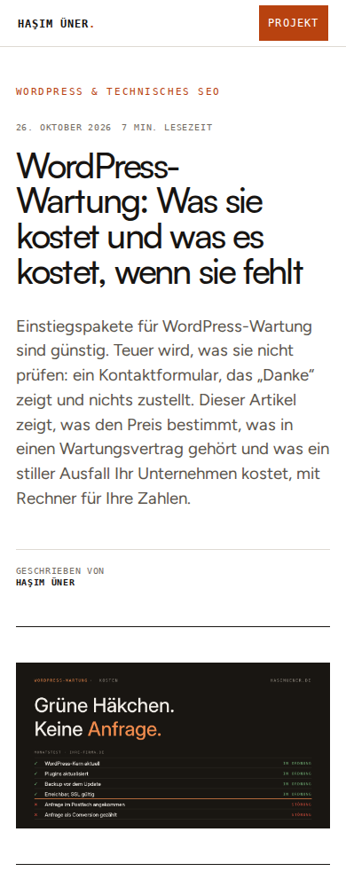
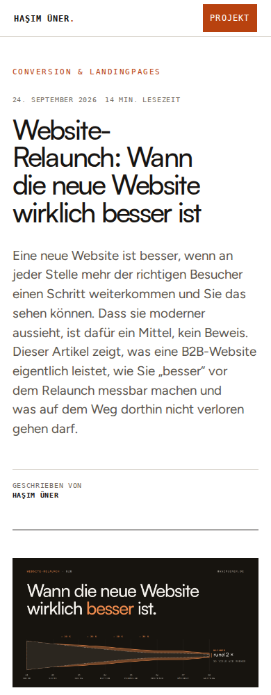
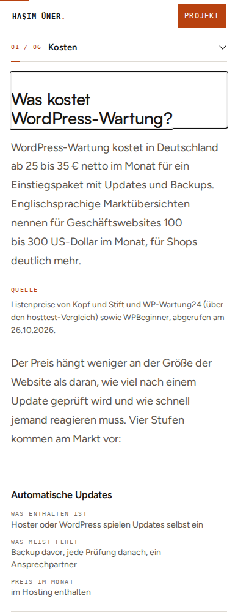
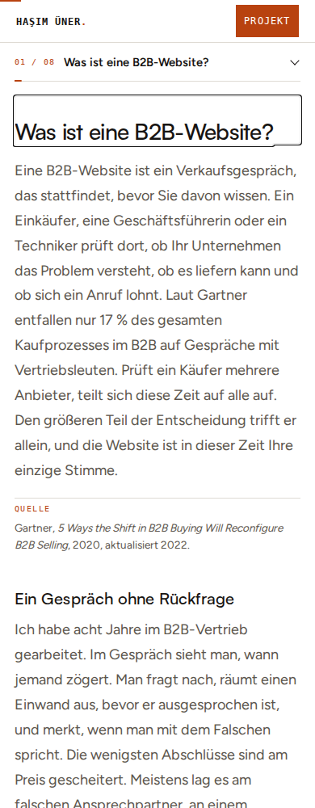
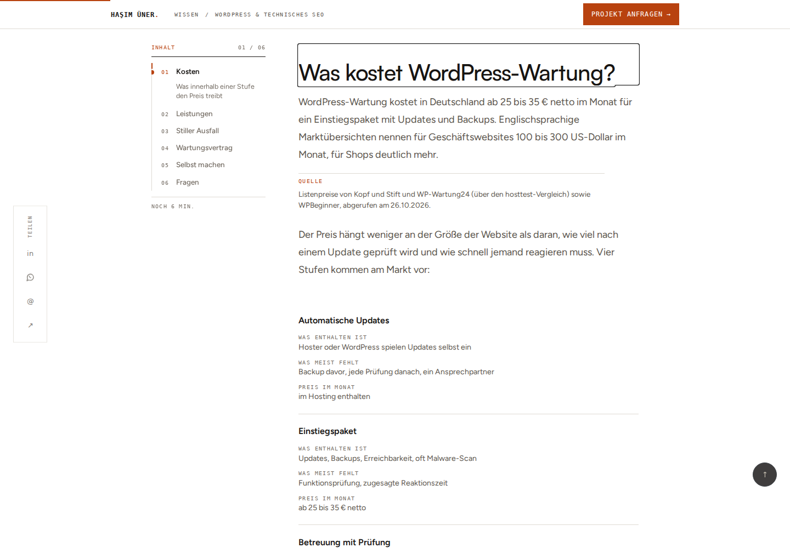
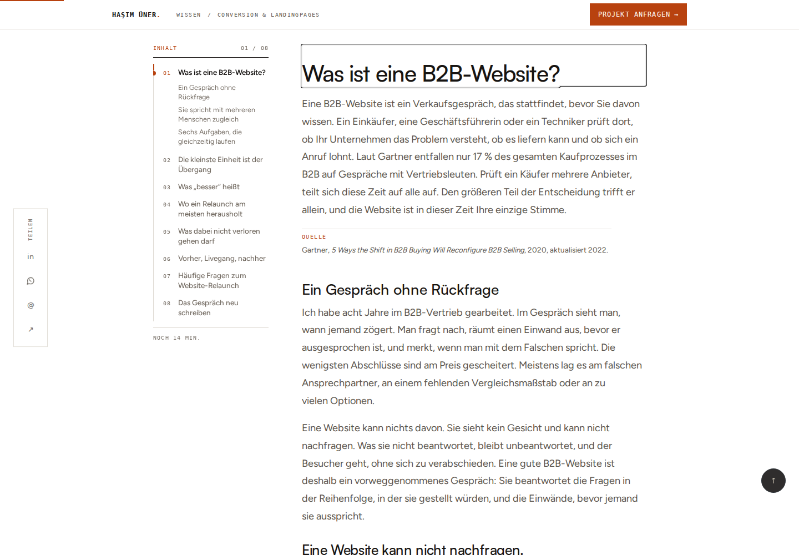
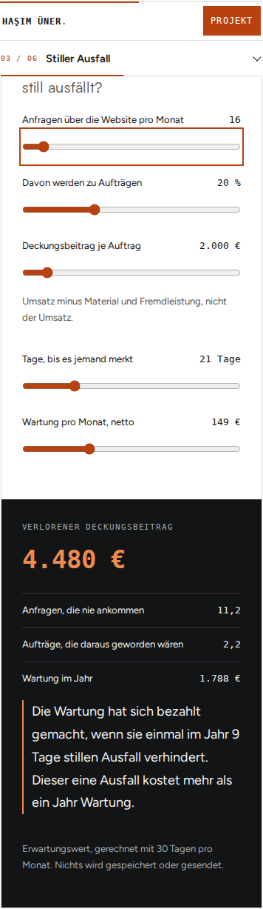

# BD-READER@2026-11-01-v1 · Wartung und Relaunch

Die beiden neuesten fachlich passenden Referenzartikel behalten ihre Inhalte,
eigenen Bilder, Rechner, Abbildungen, Prüflisten und Anfrageziele. Der gemeinsame
Reader bekommt lesbarere Typografie, ein vollständig dargestelltes Cover und
eine per Tastatur verlässliche Kapitelskala. Umsetzung auf main nach PR #633,
Basis `27cfa8bd1f853d47a9cdba7dfda53dc1f3fa01aa`. Hasims konkretes Go zur
schrittweisen Umsetzung liegt vor. Claudes unabhängiges Blog-Urteil steht aus.

## Belegte Abweichungen und Änderung

| ID | Beobachtung | Gemeinsame Lösung / Abnahme |
| --- | --- | --- |
| BD-02 | Live-TOC-Unterpunkte sind trotz visuell eingeklappter Kapitel noch fokussierbar. Der Bewegungswunsch wurde nur beim Laden erfasst. | Inaktive Unterlisten sind `hidden`; fokussierte Unterpunkte bleiben bis Fokusverlust sichtbar. Kapitelwechsel hält Zielüberschrift unter Header/Mobil-TOC sichtbar und setzt den Fokus. Aktueller Reduced-Motion-Wunsch führt zu einem sofortigen Sprung. |
| BD-02 | Lange mobile Titel sind durch die bisherige 12vw-Skalierung sehr groß, Fließtext ist auf 16 px abgesenkt. Kategorie erscheint zusätzlich zum Kicker nochmals als Metabutton. | H1 maximal 80 px, mobil 36–42 px; mobile Lesespalte 18 px / 1.7. Metazeile konzentriert sich auf Datum und Lesezeit, Kategorie bleibt im Lesepfad und Kicker. |
| BD-03 | Live-Wartung bei 1363 px: Cover 1100 CSS-px, `sizes="…50vw"` wählt eine 768-px-Variante. Festes äußeres Bildverhältnis kann passende eigene Motive beschneiden. | `sizes` folgt tatsächlichen Gutachten-Gutters (2.2rem / 3.5rem) und 1100-px-Maximum. Natürliches Bildverhältnis, `contain`. Gute 2400×1260-Motive bleiben erhalten; keine neue Bildgenerierung nötig. |
| BD-02 | Die allgemeine Reader-Absatzfarbe überschreibt die hellen Texte im dunklen Wartungsrechner, einschließlich Ergebnis und Erklärung. | Der Rechner schützt seine lokale Geräte-Palette. Alle Ergebnis-Absätze erreichen im Browsertest mindestens 4.5:1 Kontrast; keine Rechnung oder Canon-Zahl geändert. |

Der zusätzliche schwebende Nach-oben-Kreis entfällt auf kleinen Bildschirmen,
damit er keine Ergebniszahlen oder Lesezeilen verdeckt. Header und Kapitel-
Navigation bleiben erhalten.

Live-Ausgangsprüfung am 01.11.2026 im Browser: Wartung und Relaunch, Desktop
1363 px; anschließend Blog-Einstieg mit neuem Titel tatsächlich veröffentlicht
gesehen. Das belegt PR #633 am Einstieg, keinen Livegang dieses Reader-Pakets.

## Tatsächliche Prüfung

- 28 gemeinsame Nicht-Browser-Prüfungen bestanden, darunter Architektur, PHP,
  PHPStan, Routing, Permalinks und Theme-Build. `git diff --check` sauber.
- Fünf zusätzliche Browserfälle: beide Artikel bei 390×1000 und 1440×1000,
  plus Wartung ohne JavaScript. Echte PHP-Reader-, Header- und Footer-Templates,
  Original-Seed-Inhalte, Canon-Werte und produktive Shortcode-/Modul-Callbacks.
- Hero/geladenes Bild, natürliche Bilddarstellung, Dokumentbreite; alle H2
  durchgescrollt; Kapitel öffnen, Escape und Fokus-Rückkehr, Überschriftenziel
  unter den Leisten, dynamischer Reduced-Motion-Wechsel; Wartungsrechner per
  Pfeiltaste verändert; Relaunch-Abbildungen erhalten. Ausgewählte Hero-,
  Lese-, Bild-, Tabellen- und Modulansichten tatsächlich visuell angesehen.
- Vorhandene kurze TOC-Rückmeldungen bleiben bestehen; bei Reduced Motion
  keine Übergänge. Kein Absatz-Stagger oder zusätzlicher Scrollzwang.

Chrome Headless Shell 153; lokal pro Fall frischer Prozess wegen
Umgebungsgrenzen. CI nutzt den normalen Playwright-Modus. Nach Eröffnung des PR
deren tatsächliches Ergebnis separat dokumentieren, nicht vorwegnehmen.

Die Fixture ersetzt die WordPress-Datenbank durch die versionierten Artikel
und einen auf deren Tags begrenzten Shortcode-Parser. Render-Callbacks und
Canon sind produktiv; der Parser ist kein WordPress-Ersatz. WP-Filter,
editorseitige Abweichungen, echte Bild-srcset-Auswahl, andere Artikelvarianten
und Produktions-Deploy bleiben außerhalb dieses Nachweises. Alt-Text in der
Bild-Fixture ist nur ein Testwert. Keine Newsletter-/Kontaktanfrage abgesendet.
Die statische Lesbarkeit ohne JS ist geprüft; der allgemeine TOC wird weiterhin
per JS aufgebaut und ist ohne JS nicht als Navigation verfügbar.

Frontend-Guides: `modern-web-guidance` **accessibility** (Focus/Tab-Reihenfolge)
und **responsive-table** (semantische Tabellen, mobile Beziehungen erhalten).
Bestehende mobile Tabellenvarianten bleiben inhaltlich unverändert.

## Screenshots der lokalen Codefassung

| Wartung | Relaunch |
| --- | --- |
|  |  |
|  |  |
|  |  |

## Status und nächstes Paket

Zwei Pflichtartikel als lokale Codefassung umgesetzt und auf Desktop/Mobil
geprüft. Fachliche Gegenprüfung, Merge/Deploy und Produktionsabnahme dieses
Pakets fehlen noch; deshalb **0/7 vollständig abgeschlossen, 0/3 Zusatzartikel**.
Kein vollständiges neues SEO-/Copy-Audit. Nächste fachliche Einheit:
WordPress-Projekte auslagern und B2B-Landingpage, danach Tracking / Keine Anfragen
und TTFB. Die gemeinsame Änderung wirkt auch auf weitere Reader, deren
artikelweise Abnahme damit nicht behauptet wird.
